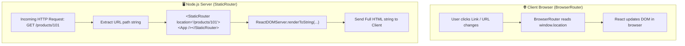

<div align="center">

# ⚡ React Router StaticRouter — Master Guide & Live Demo 🛍️

<p align="center">
  <strong>An interactive, deep-dive educational project exploring Server-Side Routing (SSR) with <code>StaticRouter</code> from <code>react-router-dom/server</code>.</strong>
</p>

<p align="center">
  <a href="https://react.dev/"></a>
  <a href="https://reactrouter.com/"></a>
  <a href="https://vitejs.dev/"></a>
  <a href="https://expressjs.com/"></a>
  <a href="https://nodejs.org/"></a>
  <a href="#license"></a>
</p>

<p align="center">
  <a href="#-project-overview">Overview</a> •
  <a href="#-architecture--how-it-works">Architecture</a> •
  <a href="#-core-concepts-explained">Concepts</a> •
  <a href="#-comparison-matrix">Router Comparison</a> •
  <a href="#-getting-started">Getting Started</a> •
  <a href="#-video-tutorials--resources">YouTube & Learning Links</a>
</p>

---

</div>

## 📌 Project Overview

When building React applications for the browser, we use `BrowserRouter` which monitors `window.location` and browser history events (`popstate`, `pushState`). 

However, **in a Node.js server environment** (Server-Side Rendering / SSR) or **automated headless unit tests**, there is **no browser window**, no address bar, and no DOM history stack.

This project demonstrates how **`StaticRouter`** solves this problem by providing a stateless, location-driven routing wrapper that can render any route to pure HTML strings synchronously on the server.

### 🌟 Key Highlights

- 🖥️ **Side-by-Side Split-Screen Interactive UI**: Real-time controller on the left and live rendered React application on the right.
- ⚡ **Live SSR Code & HTML Inspector**: Inspect active `<StaticRouter location="...">` JSX and see the exact server-generated static HTML string.
- 🚀 **Real Express SSR Server**: Run `npm run server` to experience full Server-Side Rendering with dynamic route parsing (`/products/:id`).
- 📟 **Headless CLI Test Runner**: Run `npm run demo` in the terminal to inspect SSR output without opening a browser.
- 🛒 **Realistic E-Commerce Store**: Includes Home, Product Catalog, dynamic Product Details (`useParams`), and About pages.

---

## 🏗️ Architecture & How It Works

### Client-Side Routing vs Server-Side Routing (SSR)



---

## 💡 Core Concepts Explained

### 1. What is `StaticRouter`?

`StaticRouter` is a router provided by React Router located in the subpath `react-router-dom/server`:

```jsx
import { StaticRouter } from "react-router-dom/server";
```

Unlike client-side routers, `StaticRouter`:
1. **Never touches the browser's address bar**.
2. **Never changes the URL on its own**.
3. **Is completely stateless and immutable** — it renders the matching component for the single URL supplied to its `location` prop.

---

### 2. The `location` Prop

The `location` prop is the heart of `StaticRouter`. It specifies which route React Router should match against:

```jsx
import ReactDOMServer from "react-dom/server";
import { StaticRouter } from "react-router-dom/server";
import App from "./App.jsx";

// 1. Specify the URL to render
const url = "/products/101";

// 2. Pass it into StaticRouter's location prop
const html = ReactDOMServer.renderToString(
  <StaticRouter location={url}>
    <App />
  </StaticRouter>
);

console.log(html);
```

When `location="/products/101"` is passed:
- `<Routes>` evaluates all `<Route>` definitions.
- It finds `<Route path="/products/:id" element={<ProductDetails />} />`.
- `useParams()` inside `<ProductDetails />` receives `{ id: "101" }`.
- React outputs the rendered HTML for product #101!

---

## 📊 Router Comparison Matrix

| Feature | `StaticRouter` ⚡ | `BrowserRouter` 🌐 | `MemoryRouter` 🧠 | `HashRouter` #️⃣ |
| :--- | :--- | :--- | :--- | :--- |
| **Package** | `react-router-dom/server` | `react-router-dom` | `react-router-dom` | `react-router-dom` |
| **Environment** | Server (Node.js) / SSG / Headless tests | Web Browsers (HTML5 History API) | Testing (Jest/Vitest), React Native | Legacy browsers, static file hosting |
| **URL Source** | Explicit `location` prop string | Browser address bar (`window.location`) | Internal memory array/history stack | URL hash (`window.location.hash`) |
| **State** | Stateless (One-time render) | Stateful (Listens to user navigation) | Stateful (In-memory stack) | Stateful (Listens to `hashchange`) |
| **Primary Use** | Server-Side Rendering & pre-rendering | Single Page Applications (SPA) | Unit & component testing | Environments without URL rewrite support |

---

## 📁 Project File Structure

```text
REACT-ROUTER-PROJECT-10/
├── 📄 server.js               # Express SSR Server with Vite custom middleware
├── 📄 demo-ssr.js             # Headless CLI demonstration script
├── 📄 index.html              # HTML template
├── 📄 package.json            # Project dependencies & scripts
├── 📄 vite.config.js          # Vite configuration with React plugin
└── 📂 src/
    ├── 📄 App.jsx             # Main Routes definition (<Routes>, <Route>, 404 fallback)
    ├── 📄 main.jsx            # Interactive side-by-side split screen UI
    ├── 📄 server.jsx          # SSR helper functions using StaticRouter & ReactDOMServer
    ├── 📄 index.css           # Modern theme & split-screen styling
    ├── 📂 components/
    │   └── 📄 Navbar.jsx      # Navigation header with active links
    └── 📂 pages/
        ├── 📄 Home.jsx        # Landing page (Route: "/")
        ├── 📄 Products.jsx    # Product catalog (Route: "/products")
        ├── 📄 ProductDetails.jsx # Dynamic product page with useParams() (Route: "/products/:id")
        └── 📄 About.jsx       # Educational overview page (Route: "/about")
```

---

## 🚀 Getting Started

### Prerequisites

- [Node.js](https://nodejs.org/) version **18.0.0 or higher**
- `npm` or `yarn` or `pnpm`

### Installation

```bash
# 1. Clone or open the project folder
cd REACT-ROUTER-PROJECT-10

# 2. Install dependencies
npm install
```

---

## 🎮 Running the Project (3 Modes)

### Mode 1: Interactive Split-Screen UI (Recommended for Learning)

```bash
npm run dev
```

Open [http://localhost:5173](http://localhost:5173) in your browser:
* **Left Panel**: Interactive Controller — switch routes, type custom URLs, and view live SSR HTML.
* **Right Panel**: Live React Store rendered directly inside `<StaticRouter location={currentUrl}>`.

---

### Mode 2: Real Express SSR Server

```bash
npm run server
```

This starts an actual Express Node.js server on port **3000**. Open any of these in your browser:
* 🏠 **Home Page**: [http://localhost:3000/](http://localhost:3000/)
* 📦 **Products Catalog**: [http://localhost:3000/products](http://localhost:3000/products)
* 💻 **Product #101 (Laptop)**: [http://localhost:3000/products/101](http://localhost:3000/products/101)
* 📱 **Product #102 (Mobile)**: [http://localhost:3000/products/102](http://localhost:3000/products/102)
* 🎧 **Product #103 (Headphones)**: [http://localhost:3000/products/103](http://localhost:3000/products/103)
* ℹ️ **About Page**: [http://localhost:3000/about](http://localhost:3000/about)

---

### Mode 3: Terminal CLI Headless SSR Demo

```bash
npm run demo
```

Renders all routes through `StaticRouter` synchronously in your terminal and prints the extracted HTML structure.

---

## 🗺️ Routes & Parameters Reference

| Path | Component | Description | Sample URL |
| :--- | :--- | :--- | :--- |
| `/` | `Home` | Store overview and quick route links | `http://localhost:3000/` |
| `/products` | `Products` | Catalog of available electronics | `http://localhost:3000/products` |
| `/products/:id` | `ProductDetails` | Dynamic route using `useParams()` | `http://localhost:3000/products/101` |
| `/about` | `About` | Deep-dive guide into `StaticRouter` | `http://localhost:3000/about` |
| `*` | *(404 Not Found)* | Catch-all wildcard for undefined URLs | `http://localhost:3000/unknown` |

---

## 📺 Video Tutorials & Learning Resources

Master React Router v6, Server-Side Rendering (SSR), and `StaticRouter` with these curated tutorials and official documentation:

### 🎥 Recommended YouTube Video Tutorials

| Tutorial Topic | Creator / Channel | Link |
| :--- | :--- | :--- |
| **React Router 6 Full Course & Deep Dive** | FreeCodeCamp / Web Dev Simplified | [▶️ Watch on YouTube](https://www.youtube.com/results?search_query=react+router+v6+full+course) |
| **Server-Side Rendering (SSR) in React from Scratch** | Traversy Media / Jack Herrington | [▶️ Watch on YouTube](https://www.youtube.com/results?search_query=react+server+side+rendering+ssr+crash+course) |
| **Understanding React Router Routers (StaticRouter vs BrowserRouter)** | Academind / Codevolution | [▶️ Watch on YouTube](https://www.youtube.com/results?search_query=react+router+staticrouter+vs+browserrouter) |
| **Vite SSR Setup with React & Express** | Jack Herrington | [▶️ Watch on YouTube](https://www.youtube.com/results?search_query=vite+ssr+react+express) |

### 📚 Official Documentation & Links

- 📖 [React Router Official Documentation](https://reactrouter.com/en/main)
- 📖 [React Router StaticRouter Reference](https://reactrouter.com/en/main/router-components/static-router)
- 📖 [React `ReactDOMServer.renderToString()` Docs](https://react.dev/reference/react-dom/server/renderToString)
- 📖 [Vite Server-Side Rendering (SSR) Guide](https://vitejs.dev/guide/ssr.html)

---

## ❓ Frequently Asked Questions (FAQ)

<details>
<summary><strong>Q: Why can't I use <code>BrowserRouter</code> on the server?</strong></summary>
<br />
<code>BrowserRouter</code> relies directly on browser APIs such as <code>window.location</code>, <code>window.history</code>, and DOM events. In Node.js, <code>window</code> is <code>undefined</code>. Attempting to run <code>BrowserRouter</code> on Node.js will result in a runtime error: <code>ReferenceError: window is not defined</code>.
</details>

<details>
<summary><strong>Q: Can <code>Link</code> tags work inside <code>StaticRouter</code>?</strong></summary>
<br />
Yes! <code>StaticRouter</code> provides the necessary context so that <code>&lt;Link to="/products"&gt;</code> renders proper <code>&lt;a href="/products"&gt;</code> tags in the generated HTML.
</details>

<details>
<summary><strong>Q: Does <code>useParams()</code> work with <code>StaticRouter</code>?</strong></summary>
<br />
Yes! When you pass <code>location="/products/101"</code> to <code>StaticRouter</code>, React Router parses the path against <code>/products/:id</code> and extracts <code>{ id: "101" }</code> during server-side rendering.
</details>

---

## 📝 License

This project is open source and available under the [MIT License](LICENSE).
